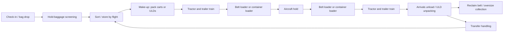

# Baggage handling: requirements and asset plan

Status: **one staffed baggage-depot example in the main Sandbox, with optional container handling in its review scene**.

**Stand staging** places loaders and empty trains beside their assigned stand, separately from the baggage
dispatch/arrivals endpoints. Parking follows the stand frame and the configured cargo-door side, including when the
stand is turned or placed on the opposite side of a taxilane. Shared stations pack jointly, preserving arrival
clearances, engine space, train entry/exit aisles and the other equipment's cargo working lanes. The layout uses
generated vehicle bounds and hitch dimensions, including the complete cart count. If it cannot fit, handling
waits with an explicit staging problem. Compact terminal/bridge stands may need a larger pad or manual parking.
Correcting the layout clears its staging problem. Unchanged layouts, including failures, are cached; the joint
placement search is bounded so a crowded stand cannot stall Play mode repeatedly.

The station setup panel toggles stand staging and chooses an assigned stand as the equipment home. One equipment
set may still serve several stands. Manual loader parking remains available when staging is switched off.
Layout edits and idle station changes update both fleet poses and red-and-white shared equipment courts.
Each home stand gets one large EQUIPMENT area enclosing its loader and train; bulk and ULD equipment on the
same stand share it. Modest reserve space (1–1.5 m outboard/ahead and up to 0.5 m aft) keeps compact stands
compact while allowing several items in the same area. The painted
area is at least 50% larger than the summed individual parking envelopes and adapts to the available paved apron,
while keeping clear of aircraft arrival envelopes, roads, buildings and neighbouring equipment. An L-shaped
corner keeps the narrowbody nose clearance outside the court. Individual
vehicle positions remain unpainted inside the court. Manual parking retains individual equipment bays. Dashed white
BAGGAGE / ULD TRANSFER outlines mark the train's working area at each served cargo door. Setup is
locked while either bulk or container handling is unfinished on the served stand. Loaders dock before the train
enters the cargo working position; after handling, the loader returns before the empty train parks at the stand.
The return planner tries longer final straights when a parked loader constrains the dolly's turning approach.
The final whole-train parking footprint and all articulated movements still receive physical clearance checks.
Tug approaches check parked equipment and move the crossing turn beyond the bays when needed, so a completed
turnaround can depart while its equipment stays at the stand. See [airfield markings](airfield.md) and
`StandStagingReview.FromCommandLine` for native Sandbox captures in `Captures/StandStaging/`.
Verification (2026-11-06): **147 distinct Unity checks have passing latest results**, covering headless handling,
stand/traffic/tug integration, road closures, native Sandbox Play startup, cancellation/retry and whole-train
parking. Saved Sandbox reviews also complete both departures: 120 arriving / 180 departing narrowbody bags,
and 2 incoming / 3 outgoing LD3s plus 20 incoming / 30 outgoing bulk bags (380 bags / 5,700 kg) for the widebody.
Both equipment sets return before taxi. Parked vehicles stop their wheel/light motion, and finished visits
expose transfer timing safely after releasing the crew. Results: `Logs/stand-staging-verification.json`.
Compact shared-court verification (2026-11-06): **28 layout, route and paint checks pass**, including compact
reserve space, the actual parked fleets, five headings and aircraft-clearance cutouts.
Results: `Logs/shared-equipment-courts.xml`. The earlier native staging previews show shared equipment courts, working
areas and both airport orientations in `Captures/StandStaging/`.

Turnarounds unload to arrivals, load a departing hold, withdraw the loader and return the train, then close the
animated cargo hatch before releasing departure. All five aircraft have operable cargo-door geometry.
See [the equipment asset guide](../assets/BaggageEquipment.md).
Repository review and external references checked 2026-11-02.

User direction: determine the baggage-handling requirements before making the assets. The eventual visual
style is **realistic**: real proportions, plausible construction, materials and mechanical movement.
The equipment choices and implementation stages below are recommendations, rather than additional user decisions.
The user authorised starting the first equipment set and deferred aircraft work (2026-11-02).
The user subsequently authorised the first working bulk-delivery slice, retaining logical holds while aircraft
changes remain deferred (2026-11-02).
The user authorised the container equipment and widebody turnaround (2026-11-03), retaining logical holds.
The user subsequently authorised working cargo doors and animations on every aircraft model (2026-11-03).
The next milestone adds close loading, with terminal facilities deferred. The user requested moving the
narrowbody forward hatch toward the nose, as on a 737, and updating its hold; loaders must face square
to the fuselage (2026-11-03).
The user authorised ramp crew next (2026-11-03), retaining the terminal-facility deferral.
The user authorised multi-cart bulk trains, more detailed hold packing and arrival marshallers next, with bag-tag
scanning deferred (2026-11-03).
Equipment must remain unbranded: do not bake the game's name or a handler logo into meshes/textures. Existing
bulk equipment was regenerated to remove the previously baked name; functional IDs/capacity markings remain.

## Widebody container turnaround

Open `Assets/AirCity/Scenes/ContainerTurnaround.unity` and enter Play mode, or regenerate it through
**AirCity > Vehicles > Create Container Turnaround Review**. Two arriving LD3s carry **120 bags / 1,800 kg**;
three departing LD3s carry **210 bags / 3,150 kg**. A second tractor/cart/belt-loader set handles **20 arriving /
30 departing loose bags** through the widebody's bulk point. The review closes the bulk manifest after container
handling so the two service areas operate in sequence. Departure is requested early and must wait for both.
The HUD offers pause/speed, blocked access, cancellation and retry. See [container equipment](../assets/ContainerEquipment.md).

`ContainerHoldConfiguration` explicitly names its aircraft, cargo point, accepted ULD code, slot count and
gross-weight capacity. Resolution checks the generated container envelope against the opening, loader sill
range, dolly gross capacity and main-platform transfer height. An AKE cannot substitute for an AKH. The current
operational scope is one ULD per dolly, one forward container hold and a separate logical bulk hold.

`Airport.Baggage.RequestContainers(aircraft, stand, configuration, station, arrivalFlight, departureFlight,
out reason)` queues a job. Create units in `job.Hold` or `job.Fleet.Dispatch` through `Airport.Baggage.Containers`,
pack batches with `ContainerLedger.Pack`, seal each ULD, then close the job manifest with `job.Seal`.
The container ledger shares the airport's `BaggageLedger`: bags stay in one contents store while a ULD moves
between bays. ULD IDs and flight assignments are immutable; stale/duplicate handovers, wrong flights, incompatible
codes, unsealed transport and capacity violations are refused. Gross weight includes tare. A sealed contents
store refuses bag additions/removals. Screening can be released through the existing batch `Screen` API.

`ContainerTurnaround` drives the loader in, deploys stabilisers, raises its front platform, and brings the dolly
to a validated side-transfer pose. Incoming ULDs move hold → front → main; the main platform lowers to dolly
height, opens its side gate and extends its transverse roller bridge for main → dolly. At arrivals the ULD is
opened, bags are unpacked into the arrivals store, and the empty unit goes to the recorded yard. Departures
reverse the equipment sequence. The same visible ULD interpolates across each handover; simulation ownership
changes exactly once at its completion. Platforms must align before a handover. Restraints close for travel.

`ContainerStation` saves the equipment references, hall road endpoints/headings, loader parking, hall/arrivals
capacities and unpack rate. The coordinator owns the operational state and leases. Bulk and container planning
share road filtering, articulated trailer clearance, surface/aircraft/bridge exclusions and working reservations.
Container approaches also validate the complete tractor/dolly against the working loader and use the dolly's
generated turning radius. A deployed side bridge participates in equipment avoidance.

Cancellation completes a moving handover, recovers any unit on the platforms to the dolly, delivers incoming
units to arrivals and returns undelivered outgoing units to dispatch. Equipment remains leased until the dolly
returns, platforms lower, stabilisers retract and the loader parks. A cancelled manifest blocks departure;
retry continues that same manifest without recreating units or bags. Blocked access, screening and full bays
wait while retaining the current records and equipment. Multiple dollies and AKH support remain later work.

Batch review (use an isolated project copy while the editor is open):

```sh
rtk proxy timeout 300 /Applications/Unity/Hub/Editor/6000.6.7f1/Unity.app/Contents/MacOS/Unity -batchmode -projectPath . -executeMethod AirCity.EditorTools.Vehicles.ContainerTurnaroundSetup.FromCommandLine -logFile Logs/container-setup.log
```

Captures go to `Captures/ContainerTurnaround/main-lift.png` and `platform-transfer.png`. `ContainerTurnaroundTests`
covers contents sealing, gross weight/tare, screening, compatibility, moving LODs, mechanical poses, fixed time,
both platforms, blocked transfers, cancellation/retry, full arrivals, manifest recovery and shared departure clearance.

Verified 2026-11-03 in the isolated Unity project copy: **109 checks passed**, including **24 container checks**
and the existing baggage equipment/delivery/sandbox/turnaround, tug and maintenance suites. The Play-mode review
also passed. The batch review unloaded two arriving LD3s and loaded three departing LD3s, handled 20 arriving /
30 departing bulk bags, conserved all **380 bags / 5,700 kg**, returned both equipment sets and reached departure
taxiing. Results are in `Logs/container-final-tests.xml` and `Logs/container-final-tests.log`; the batch review
log is `Logs/container-setup.log`. The review scene, equipment prefabs and generated Unity metadata are present
in the main project.

## Baggage depots and hired crews

The main Sandbox has one narrowbody baggage example and one Small baggage depot. The optional container
review and its installer remain available separately; generating the normal airport no longer installs a
second widebody example. The original isolated handling scenes remain test fixtures and are not loaded
additively when entering Play.

`BaggageDepot` is a shared destination and workforce owner. Its parametric warehouse has drive-through
team bays off a shared service-road spine, labelled ground markings, collection/unloading conveyors and visible stored luggage. Each team
uses the same physical bay for arrivals and departures: after unloading it collects the next load there,
without a separate circulation lap between two invisible endpoints. Each bay has a forward entry and exit;
parked tractors and every trailer stay outside the through lane. The trailer remains stationary during
handovers. Bags move between carts, conveyors and shared ledger stores; the bounded visual pools do not
change ownership or drop records. The depot footprint participates in aircraft/equipment clearance.

| Depot size | Maximum tractor/cart teams | Maximum trailers | Maximum hired workers |
|---|---:|---:|---:|
| Small | 2 | 4 | 8 |
| Medium | 4 | 12 | 20 |
| Large | 8 | 24 | 40 |

The Baggage sidebar offers **Hire worker**, **Dismiss worker**, **Crew per team**, **Depot size**, **Add team**
and **Build depot**. Building needs paved ground, clear space beside a service road and enough straight road frontage for all
bay entries and exits. **Build size** selects the next depot independently of the existing depot’s upgrade. Upgrades need
space for the larger warehouse and sufficient paved coverage; downgrades refuse excess equipment, staff
or stored luggage. This is headcount management; wages and hiring costs await the game's economy.

A dispatched team leases 2–4 available workers: one cart handler and one hold handler, then a second cart
handler and a second hold handler. Additional workers have separate animated roles and alternate bags.
Cadence is the slower ground/hold workload divided by its assigned staff count, bounded by the configured
belt/transfer interval. Conveyor travel and individual walking/lifting durations remain unchanged. Hiring
can expand an active crew between batches; an ongoing bag handover keeps its assigned workers. Dismissal
only removes idle staff, so an aircraft never loses its operator or a worker holding a bag. Assigned staff
return to the available pool after equipment recovery, including cancellation. Idle workers appear at the
depot; equipment without an assigned crew does not show permanently occupied driver seats.

Teams at a depot share dispatch and arrivals stores, preserving capacity, screening, flight ownership and
conservation. **Add team** creates a distinct bay, tractor/cart train, loader and lease, within the depot's
limits. Bay roads are prepared when the depot is built, so buying a team does not rebuild airport geometry
or cancel an ongoing turnaround. Stands can share the depot's teams; automatic manifests choose the least queued eligible team.
The station registry is cached until stations change. Waiting visits do not construct service routes before
dispatch. The 50-stand test checks queue distribution and bounded workforce, not 50 simultaneous completed
turnarounds or a rendering frame-rate guarantee.

The staging allocator now propagates a candidate's constraints to remaining items and caches pair
compatibility. It preserves candidate order and the previous first valid parking arrangement. The measured
shared widebody case fell from 5,860,081 checks / 6.7 s to 319,580 pair checks / 0.7 s. Its layout is cached
until geometry or equipment inputs change. The normal Sandbox avoids this optional example entirely.

`BaggageDepotReview.Run` verifies the actual default turnaround through depot unloading, collection,
loading and departure, captures native frames in `Captures/BaggageDepot/`, and logs startup and mean
simulation-step timing. `BaggageDepotTests` covers capacities, hiring/firing, shared stores, team bays,
50-stand queueing, changing crew size between batches, throughput and conservation.
Verification (2026-11-06): 49 depot/layout/crew/Sandbox checks and 82 turnaround regressions pass
(one overlapping installer check). The 50-stand queue setup measured about 36 ms with four teams and
eight leased workers. Buying a team during active handling preserves the layout version and the original
turnaround completes with every bag conserved. Native Play startup and full default-depot captures are
recorded separately in `Logs/baggage-depot-play.xml` and `Logs/baggage-depot-native.json`.

## Close docking and visible transfers

The loader stops at a clearance staging point, the hatch opens, the belt/front platform rises to the sill,
and the loader creeps forward at 0.5 m/s. After handling, the train returns home, the loader reverses straight
out with its working height retained, then lowers and drives to parking. Only after this does the hatch close
and departure clearance release. Container stabilisers retract before withdrawal.

`AircraftType.serviceFootprints` separates the closed fuselage, wings, engines, tail and landing gear. They are
generated from tagged source geometry; runtime code does not read render meshes. Only the belt/roller-deck
nose may enter the serviced fuselage's projected overhang in the aligned hatch lane, while its tip remains
outside the sill. Fuselage, engines and gear retain their footprint checks. Wings and tail use their generated underside
heights: only equipment whose full working height clears by 0.25 m may pass beneath them. Container loaders face square to the door, offset to
centre the asymmetric ULD contour; dollies rotate their deck to align with the main platform and return it
to its travelling position before driving. Other aircraft retain the conservative
whole-aircraft exclusion. Terminal/bridge, road, pavement and live vehicle checks still apply. Passenger bridges reserve per-part
envelopes over their assigned docking/retraction paths, rather than a square covering every possible swing
about the rotunda; the opposite aircraft side remains usable.

`BaggageLoadPath` supplies conveyor endpoints. `BaggageCrew` supplies handover timing and bag positions from
cart to belt rear, along the belt and through the opening, or the reverse on unloading. `BaggageLoadVisuals` pools existing suitcase/duffel
prefabs and displays cart/hold loads. Batch ownership transfers atomically after the last bag arrives; visuals
do not own baggage. Blocked access pauses the timer. Cancelling a running aircraft handover finishes that
batch before withdrawing, retaining all counts and weights.

ULD hold endpoints now sit inside the real opening. Hold liners use a flat recessed back plane rather than
following the curved exterior skin; `cargoDoors.holdDepth` describes their usable depth. Remote hold slots
remain logical, and the visible bulk piles are bounded representations of stored baggage. Detailed interior
load planning remains future work. Terminal facilities are explicitly out of scope for this milestone.

`AirCity.EditorTools.Vehicles.BaggageDockingReview.FromCommandLine` assigns missing bag-art references in
existing station scenes, then captures complete narrowbody bulk and widebody container operations into
`Captures/BaggageDocking/` without rebuilding saved layouts.

Loading verification (2026-11-03): the broad regression passed 106/107 cases, exposing a cancelled-arrivals
cleanup bug. After fixing it, all 12 cancellation/retry/combined-service checks passed; the latest result
for each of the 107 unique cases is Passed (`Logs/baggage-loading-verification.json`). Source runs are
`Logs/baggage-loading-final.xml` and `Logs/baggage-loading-recovery.xml`. The final capture run produced
14 images, including perpendicular loading from above and the rear bulk hold; it conserved all 90 narrowbody
bags and all 380 widebody/container/bulk bags (5700 kg), returning equipment and closing hatches. See
`Logs/baggage-loading-captures-final.log`.


## Multi-cart trains and hold packing

Bulk stations expose **Carts per train** while idle. The saved narrowbody sandbox station and turnaround review
use two carts; each has its own bag/count and weight capacity. Container dollies remain single-unit trains.
The tractor and every cart keep their own axle/drawbar poses, with cart-to-cart hitches constrained continuously
through turns. A blocked rear cart stops the entire chain before any link commits that movement. Route previews
clone all cart poses, validate every trailer, include the complete parked train in loader clearance and reserve
the longer service footprint. Long trains need adequate roads and apron space; a failed route leaves the job waiting.

`BaggageFleet.Carts` owns the separate stores; `ActiveCart` selects the handler's current source/destination.
`CartCount`/`CartWeight` report whole-train load. Hall collection fills available carts without exceeding either
capacity. At the aircraft the tractor stays stopped while the handler walks between carts and carries each bag
to/from the belt. Their return path leads back to the tractor before driving. Cancellation returns every
undelivered batch from every cart, and retry resumes the same manifest. The original single-cart API remains
the default for delivery and container routing.

`BaggageHoldPacking` assigns stable positions in the generated hold envelope. It fills deeper rows and the far
ends of each row first, building each stack from the floor upward while reserving an aisle and doorway work bay.
Arriving loads unload in the reverse accessible order. A bag retains its model variant through the handover;
stack heights use the generated suitcase/duffel dimensions. The hold worker travels through the aisle to the
assigned position, places or collects the bag, then returns to the belt. The bag cadence includes the longest
hold path in the active batch, so the worker is free before the next bag arrives.

Aircraft data supplies `holdSideMin`, `holdSideMax`, `holdHeight`, `holdFloorStart` and `holdDepth`. The floor-start
inset matters where the shell tapers. The narrowbody's existing full bay is used; the widebody bulk liner now
extends between stations 48.2–52.2 m. The packing slots describe the modelled compartment, while the configured
logical hold capacity can include additional unmodelled space. Baggage records beyond the visible slots remain
conserved and undergo the same handling sequence. This is presentation packing, without a weight-and-balance model.

`GroundHandlingReview.FromCommandLine` installs the saved station/crew references and captures two loaded carts,
second-cart handling, the packed interior and a real guided arrival into `Captures/GroundHandling/`. It handles
120 incoming and 150 outgoing bags with one train trip in each direction. See [traffic](traffic.md) for marshallers.

Verification (2026-11-03): **157 unique checks have passing latest results**, covering multi-cart hitch motion,
rear-cart blockage, individual payloads, reduced trip counts, cancellation/retry, generated packing envelopes,
crew reach, live marshaller/wands, traffic and delivery. `Logs/ground-handling-verification.json` records the
source run for every case. Earlier failures exposed the longer handling time, legacy single-cart trip assumptions,
a terminal-side withdrawal, a rotated-bag reach and a wall-time-dependent Play-mode test; all were corrected.
The final review conserves all **270 bags**, returns both carts and the loader, closes the hatch and guides a
separate real arrival onto its configured stop. Six screenshots are in `Captures/GroundHandling/`.

## Ramp crew

The bulk fleet has two workers: the tractor driver gets out to handle bags beside the cart and belt, while
the loader operator enters the hold after docking. Loading waits for both. The ground handler reaches,
lifts, turns, carries and places one bag, then returns for the next. The hold handler kneels to receive and
stow it; unloading reverses the sequence. A worker can hold at most one bag at once. Bags travel independently
on the conveyor between handovers. A narrow clear lane beside the bounded hold display piles accommodates the worker.

`BaggageCrew` belongs to `BaggageFleet`, advances through the turnaround's fixed game-time step, and works without
character prefabs or rendered frames. Its boarding paths remain fixed while returning. The tractor cannot drive
until its handler returns to the seat; loader withdrawal waits for the hold handler to exit and sit down.
Cancellation finishes an active bag batch, recalls the workers and then withdraws. Blocked access freezes
boarding and handovers. Pausing the airport freezes both crew and baggage.

`TransferInterval` is the greater of `secondsPerBag` and either worker's complete handling cycle. `BagTravelSeconds`
includes the pick/lift/carry/place phases, conveyor travel and destination handling. The ledger still transfers
each batch atomically after its final visual handling cycle. Dispatch/arrivals remain logical endpoints with
their existing timers while terminal work is deferred. Crew are assigned to their equipment set; a separately
managed workforce, shifts, fatigue, staffing costs and scanner/reconciliation gameplay are future work.

Container tractors have seated drivers; container loaders have standing operators at the controls. ULDs remain
roller-transferred. The same shared worker uses three skinned LODs, a single material per LOD and four uniform/skin
palettes. `RampCrewRig` solves limbs against palm targets; carried bags attach to a hand socket. The presentation
uses simulation times, so culling or omitted visuals cannot advance a handover. Bone updates stop beyond 250 m.

Generated vehicle `crew` metadata supplies the actual seat/platform position, palm and foot targets and occupied
height. Service clearance includes that occupied height. `RampCrewType` imports the generated `.crew` timing and
dimension profile. See [RampCrew](../assets/RampCrew.md) for source, generation, installation and capture commands.

Crew verification (2026-11-03): **111 unique checks pass**, including the Play-mode sandbox and turnaround
reviews, crew interlocks, paused/blocked work, cancellation/retry, suitcase grip/floor poses and regenerated
equipment. `Logs/ramp-crew-verification.json` merges the latest result per case from `ramp-crew-final-tests.xml`,
`ramp-crew-equipment-tests.xml` and `ramp-crew-equipment-final.xml`. The final equipment run updates the old
loader length assertion to include the new rear stairs; the belt itself remains 7.8 m.
Fourteen close-up captures in `Captures/RampCrew/` show driving, access, cart/belt handovers and kneeling in
both the narrowbody and the widebody's low bulk hatch. The capture simulation returned both equipment sets,
closed the hatches and conserved all **90 narrowbody bags** and **380 combined container/bulk bags**; see
`Logs/ramp-crew-captures-final.log`.

## Aircraft cargo doors

Every cargo service point has a separate painted panel, an opening in the fuselage, metallic jambs and a shallow
lined hold. Large jet hatches swing outward/upward, widebody bulk hatches swing inward/upward, and the Cessna's
port baggage hatch swings around its forward edge. These are simplified hinge animations, not detailed latch or
hydraulic-actuator simulations. Hold contents and capacity still belong to the baggage/container ledgers.

`AircraftType.cargoDoors` supplies the service-point name, transform, pivot, axis, opening angle and duration.
`AircraftCargoDoors` eases each hatch independently. Bulk handling opens its configured door before raising the
belt; container handling opens before raising its front platform. Hold transfers require a fully open door.
Both jobs keep control of the hatch during service and close it after equipment returns, including cancellation
and retry. Completion and departure readiness wait for closure; an unrelated manually opened hatch also blocks
departure. Door movement uses the turnaround's fixed game-time step and does not depend on rendered frames.

Select a parked aircraft in the sandbox and use **Open cargo / Close cargo** to review its hatches. Manual controls
leave doors being serviced under the turnaround's control. LOD0/1 retain moving panels; LOD2 merges the closed
panels into the distant aircraft. See [aircraft](aircraft.md) for generation and close-up capture commands.

Cargo-door verification (2026-11-03): all five regenerated models cover **12 cargo points**; **36 Unity captures**
show closed, open and medium-LOD poses in `Captures/CargoDoors`. The broad aircraft/livery/baggage/container/tug/
maintenance run passed 184 of 185 checks and exposed a far-LOD registration material. After correcting that,
**19 focused checks passed**, including every rig and LOD, successful bulk/container turnarounds, aircraft removal
mid-handover in both directions and removal of a door panel. The latest results cover **188 unique passing checks**.
See `Logs/cargo-final-tests.xml`, `Logs/cargo-fix-tests.xml` and the merged `Logs/cargo-verification.json`.

## Main sandbox container handling

Open `Sandbox.unity`, enter Play and expand **CONTAINERS > View station**. The remote widebody stand has a
container hall, a separate bulk station, service-road circuits and a large tug. Container demand defaults to
**120 arriving / 210 departing bags** at **15 kg per bag**, packed into two arriving and three departing AKEs.
The companion bulk station handles **20 arriving / 30 departing bags** after the container equipment returns.
Both jobs use the same arrival/departure flight assignments. Select the aircraft and choose **Depart** to request
departure; handling and equipment return must complete before a tug is dispatched. Normal arriving aircraft
generate demand only after parking on a station's assigned stand.

**CONTAINER STATION SETUP** selects/adds stations, chooses the explicit aircraft and cargo point, sets hold
slots/gross capacity, arriving/departing demand, bag weight and packing limit, and assigns stands. Dispatch,
arrivals, loader parking and their headings are placed like the bulk station's endpoints. **Bulk station**
optionally selects a separate loose-bag station; configure that station for the aircraft's bulk cargo point and
the same stands through **BAGGAGE > STATION SETUP**. New container stations start unassigned with automatic
handling off. Setup is locked while the selected station has unfinished handling. Editor authoring saves the
layout; Play-mode edits have the sandbox's usual temporary lifetime.

**Block access**, **Release screening**, **Cancel containers** and **Retry containers** are available in the
container panel or selected-aircraft inspector as appropriate. **Screen departures** chooses whether future
manifests start screened. **Send to reclaim** frees the arrivals bag bay while preserving records and departure
clearance. Cancelled jobs retain their original units, contents and manifest until retried; automatic demand
does not replace them. Completed visits create no extra demand while the aircraft remains parked. After it
leaves and returns for a new visit, fresh records are created while the old flight's records remain conserved.

`ContainerStation.automaticHandling`, `automaticHold`, `standIds`, `incomingBags`, `outgoingBags`,
`bagsPerContainer`, `kilogramsPerBag`, `outgoingScreened` and `bulkStation` are the saved configuration.
`AirportBaggage` validates the entire demand against compatibility, hold slots/gross limits and dispatch
capacity before creating units or bags. Packing is reduced when the bag weight would exceed a ULD's payload;
every capacity calculation includes tare. An invalid or full station blocks departure even if another hold's
handling has already completed. Container and bulk jobs share the existing route/clearance and fixed-time
simulation; the coordinator sequences the companion bulk fleet independently of review-scene scripts.

**AirCity > Vehicles > Enable Sandbox Containers** installs this layout into an existing sandbox while retaining
the rest of the airport. Rebuilding through **Add Sandbox Airport** installs only the staffed narrowbody/depot
example; container handling is optional.

```sh
rtk proxy timeout 900 /Applications/Unity/Hub/Editor/6000.6.7f1/Unity.app/Contents/MacOS/Unity -batchmode -projectPath . -executeMethod AirCity.EditorTools.Vehicles.ContainerSandboxSetup.FromCommandLine -logFile Logs/container-sandbox-setup.log
```

Use an isolated project copy while the main editor is open. The batch command saves the configured scene,
exercises automatic container/bulk demand through departure taxiing and captures
`Captures/ContainerSandbox/loading.png`. `ContainerSandboxTests` covers automatic generation, compatibility,
weight/slot validation, full dispatch, screening/reclaim, cancellation/retry, repeat visits, combined departure
clearance, station controls, installer idempotency and main-sandbox Play-mode startup.

Verified 2026-11-03 in the isolated Unity copy: **127 checks passed**, including **18 sandbox-container checks**
and all existing bulk/container, tug and maintenance regressions. The main-sandbox batch completed both fleets,
conserved **380 bags / 5,700 kg** for the widebody visit and reached departure taxiing. Reports are
`Logs/container-sandbox-final-tests.xml` / `.log`; the batch log is `Logs/container-sandbox-setup.log`.
The expanded station setup and scrolling sidebar also passed a focused Play-mode check after the UI change:
`Logs/container-sandbox-ui-tests.xml` / `.log`.

## Sandbox handling and larger manifests

The main `Sandbox.unity` includes a remote narrowbody service stand, dispatch/arrivals loop, loader parking
and a tug. In Play mode, expand **BAGGAGE** and choose **View station** to find it. Its station automatically
creates a closed manifest for each compatible aircraft visit on its assigned stands: **120 arriving bags /
1,800 kg** and **180 departing bags / 2,700 kg** by default. Its two-cart train carries each default manifest in one trip; larger manifests use repeated trips.
Aircraft from
normal sandbox traffic use the same coordinator when parked on an assigned stand; unassigned stands retain
their existing behaviour. Demand and hold capacities are explicit tuning values.

**STATION SETUP** provides station selection/creation, demand, dispatch/arrivals junction placement, loader
parking, endpoint headings and stand assignments. Configuration is locked while that station has unfinished
jobs. New stations copy equipment/hold compatibility and start with automation off. Endpoints need a forward
service-road circuit; the planner reports unusable access rather than moving equipment through obstacles.
Editor scene authoring saves the layout; Play-mode edits have the sandbox's usual temporary lifetime.

The selected aircraft inspector shows handling state, hold/cart counts and trip counts, with screening release,
cancellation and retry controls. Retry resumes the same closed manifest after equipment returns, preserving
already delivered/loaded bags. **Send to reclaim** moves arrivals into an airport-owned logical reclaim store;
it frees bay capacity without removing records or revoking a completed departure's clearance. Reclaim remains
logical pending the terminal expansion. Direct **Push back** also checks baggage readiness.

`BaggageStation.automaticHandling`, `automaticHold`, `standIds`, `incomingBags`, `outgoingBags` and
`kilogramsPerBag` are the saved configuration. `AirportBaggage` generates screened batches of at most ten bags,
reduced further to fit cart payload, once per aircraft object/visit in the sandbox. Invalid demand and a full
dispatch bay wait before generating any part of a manifest. Reusing the same aircraft object for a later flight
rotation still needs a visit/archive lifecycle; sandbox arrivals currently use new objects.

Integrated turnarounds repeat arrivals and dispatch trips until their manifests are handled. The complete train and
one loader remain leased throughout. The complete manifest must fit its hold, and each atomic batch must fit
the cart's count/weight limits. The standalone `BaggageDelivery` review retains its original single-load scope.
Multiple/parallel holds and dynamic route replanning remain future work.

**AirCity > Vehicles > Enable Sandbox Baggage** installs this layout into an existing sandbox without rebuilding
its airport; rerunning it reuses the installed station. The normal sandbox airport generator includes it too.
Headless setup and capture (use a separate project copy when the editor is open):

```sh
rtk proxy timeout 300 /Applications/Unity/Hub/Editor/6000.6.7f1/Unity.app/Contents/MacOS/Unity -batchmode -projectPath . -executeMethod AirCity.EditorTools.Vehicles.BaggageSandboxSetup.FromCommandLine -logFile Logs/baggage-sandbox-setup.log
```

This saves the initial sandbox, exercises all four cart trips, holds departure until the loader/train return,
and verifies departure reaches taxiing. Capture: `Captures/BaggageSandbox/loading.png`.
`BaggageSandboxTests` covers automatic manifests, count/weight-limited trips, cancellation/retry, reclaim,
configuration/demand refusal, direct pushback, installer idempotence and Play-mode startup.

Verified 2026-11-03 in a separate Unity project copy: **75 baggage/tug checks passed**, including station controls
and the Play-mode sandbox, plus **one automatic-arrival check** confirming manifests are created only after the
aircraft parks. The earlier traffic, maintenance and bridge regression suites also passed. The full sandbox
batch run handled all **300 bags / 4,500 kg** in four cart trips and reached departure taxiing. Reports are in
`Logs/baggage-sandbox-final-tests.xml` and `Logs/baggage-sandbox-arrival-tests.xml`; batch output is in
`Logs/baggage-sandbox-setup.log`.

## Airport-connected bulk turnaround

Open `Assets/AirCity/Scenes/BaggageTurnaround.unity` and enter Play mode, or regenerate it with **AirCity >
Vehicles > Create Baggage Turnaround Review**. AC101 lands and taxis to a real stand; handling starts after
parking. Its **30 incoming bags / 450 kg** go to arrivals, then **60 departing bags / 900 kg** are collected and
loaded for AC102. Departure is requested early so its baggage wait is visible. The loader lowers and drives
back to parking; the empty train returns to its stand bay (dispatch in manual mode); only then can traffic
send the tug and begin push-back.
The HUD has pause/speed, blocked-access and cancellation controls. The airport sandbox is a separate scene.
The user authorised this milestone with logical holds and deferred aircraft art (2026-11-02).

`Airport.Baggage` owns the ledger, hall queues, equipment leases, stand reservations and readiness checks.
`BaggageStation` saves dispatch/arrivals road nodes, their headings, loader parking, capacities, types/prefabs
and handling rate. There is one tractor/cart/loader set per station; aircraft queue for that set.
It also presents the coordinator's equipment poses without owning simulation state.

To use it from gameplay, call `airport.Baggage.Request(aircraft, stand, holdConfiguration, station,
arrivalFlight, departureFlight, out reason)`. Add incoming batches to the returned job's `Hold`, outgoing
batches to `job.Fleet.Dispatch`, then call `job.Seal(out reason)`. Explicit closure prevents missing bags
being mistaken for a completed empty manifest. Requests may be queued before arrival. Ordinary flights remain
unchanged until a baggage turnaround is requested, either by gameplay code or an enabled station's automatic
handling. The sandbox supplies configurable per-visit demand; a full airline/passenger schedule remains future work.

`BaggageServicePlan` derives poses from the aircraft's actual transform, cargo point/normal and generated
equipment geometry, checked against the stand's configured stop. The working belt/roller-deck tip stops 10 cm
outside the actual sill. Loaders face square to the opening. The narrowbody forward hatch is now 8.55 m aft of the nose,
clear of the engine intake; trains circulate outward around the wings. `Stand.baggageEntryNode` and
`baggageExitNode` optionally choose approach/exit road nodes; zero chooses nearby nodes. Plans check the cart
through every turn, loader approaches and reverse withdrawal, apron/road coverage, closed roads, taxiway exclusion, generated aircraft-part footprints,
terminals and bridge-part envelopes over assigned docking/retraction motions. Working space is reserved jointly across jobs. Live equipment
and aircraft checks can stop either vehicle; traffic and maintenance also see baggage equipment. The cart
continues between route legs without resetting its articulation.

`BaggageTurnaround` unloads hold → cart → arrivals, moves to dispatch, collects dispatch → cart, then loads
cart → hold. Empty holds are reassigned to the departing flight; batch flight/count/weight never change.
Handling waits on screening exceptions, full bays or blocked access while retaining its equipment lease.
Cancellation and stand/parking reconfiguration withdraw using the existing forward routes: incoming batches
already on the cart go to arrivals, undelivered departing batches return to dispatch, and bags still in the
hold remain recorded there. Reservations release after equipment returns. A cancelled turnaround keeps
departure blocked so partial handling cannot be mistaken for success.

`Flight.StepReady` checks `Airport.Baggage.DepartureBlocker` before tug dispatch/engine start, alongside the
existing bridge requirement. Active service reservations also keep a stand out of arrivals allocation.
`Airport.Simulate` interleaves active baggage, traffic, maintenance and bridges in 0.05-second increments.

Current scope is one explicit bulk hold and a configurable cart train making as many trips as needed. Manifests that exceed
the hold, or individual batches that exceed one cart, are refused when sealing. Shared crew staffing,
transfer-flight reassignment, automatic route replanning, the full
terminal interior remain later work. Close docking and visible bag/ULD transfers are implemented in the next section.

Batch validation and captures:

```sh
rtk proxy timeout 300 /Applications/Unity/Hub/Editor/6000.6.7f1/Unity.app/Contents/MacOS/Unity -batchmode -projectPath . -executeMethod AirCity.EditorTools.Vehicles.BaggageTurnaroundSetup.FromCommandLine -logFile Logs/baggage-turnaround-setup.log
```

Captures are in `Captures/BaggageTurnaround`: `unloading.png`, `loading.png` and `departure-clear.png`.
`BaggageTurnaroundTests` exercises actual arrival/departure integration, conservation, leases, blocked access,
full arrivals, cancellation at operational stages, stand removal, stop reconfiguration and Play-mode startup.

Verified 2026-11-03 in a separate Unity project copy: **79 checks passed**, covering both baggage reviews,
equipment, arrivals/departures, tugs, maintenance and bridge coordination. The integrated departure check runs
through push-back into taxiing. The batch review independently landed AC101, delivered 30 bags / 450 kg to
arrivals, loaded 60 bags / 900 kg for AC102, returned the train, lowered/parked the loader and began taxiing.
All 90 bags / 1,350 kg remained accounted for. The tug plans around parked baggage equipment, and the review's
service circuit connects to the taxilane for maintenance access. Results are in `Logs/baggage-final-tests.xml`
and `Logs/baggage-final-tests.log`; setup output is in `Logs/baggage-turnaround-setup.log`.

## First working bulk delivery

Open `Assets/AirCity/Scenes/BaggageDelivery.unity` and enter Play mode. **AirCity > Vehicles > Create Baggage
Delivery Review** regenerates this scene. The equipment showroom and airport sandbox are separate scenes.

The review sends **60 bags / 900 kg for AC102** from dispatch to a handoff beside a parked narrowbody. The tractor
collects six ten-bag batches, drives with its cart, transfers the batches to an explicitly configured bulk hold
and returns forwards to dispatch. Tractor, cart and belt loader remain reserved until the train returns.
The HUD offers pause, restart, cancellation, speed controls and a switchable access barrier. Right-drag orbits,
scroll zooms and WASD pans.

This earlier standalone route review retains its authored, remote handoff and amber connection line.
Use `BaggageTurnaround`, `ContainerTurnaround` or the sandbox for current close docking, visible transfers
and departure integration. This standalone delivery's `DepartureReady` flag is separate from `AirTraffic`.

Runtime code under `Scripts/Runtime/Vehicles`:

- `BaggageLedger`, `BaggageStore`, `BaggageBatch`: each batch has one location and immutable flight/count/weight.
  Atomic transfers refuse duplicate/stale handovers, wrong flights, unscreened bags and full stores. Screening
  exceptions can be released through `Screen`. Display meshes never own baggage.
- `BulkHoldConfiguration`: explicit cargo point, count/weight capacity and belt-loader sill compatibility.
  Review capacities and handling rates are tuning values, not certified aircraft data.
- `BaggageRoute`: open, sufficiently wide service roads only, with endpoint headings for forward circulation.
  `BaggageTrain`: one tractor/cart pair; generated drawbar and steering-pivot dimensions form two rigid links.
  Small distance steps maintain hitch alignment through corners. Clearance includes cart offtracking and
  conservative drawbar sweep. The review checks road corridors, aircraft footprint and the live access barrier.
- `BaggageDelivery`: fixed 0.05 game-second ticks, equipment leases, timed collection/transfer and return.
  Blocked access, screening and capacity failures wait without dropping baggage or releasing equipment.
  Cancellation returns undelivered bags to dispatch; delivered bags remain in the hold. A full dispatch bay
  retains the lease until returned bags can be accepted.

`BaggageDeliveryDemo` supplies this original scene's wiring and presentation. Changing the aircraft pose/type
pauses it until restart. For airport coordination, inbound handling and departure clearance, use the newer
`Airport.Baggage` turnaround described above. Crew, transfer operations, multiple-cart trains and automatic
route replanning remain later work.

Batch setup/captures, with the editor closed on the target project:

```sh
rtk proxy timeout 300 /Applications/Unity/Hub/Editor/6000.6.7f1/Unity.app/Contents/MacOS/Unity -batchmode -projectPath . -executeMethod AirCity.EditorTools.Vehicles.BaggageDeliverySetup.FromCommandLine -logFile Logs/baggage-delivery-setup.log
```

This saves the initial scene, captures `Captures/BaggageDelivery/overview.png`, `turning.png` and `handoff.png`, then simulates
completion and checks that all bags reach the hold and equipment is released. `BaggageDeliveryTests` covers
conservation, capacity/screening waits, leases, cancellation, fixed time, road filtering, hold compatibility,
headless and prefab hitch alignment, the operational scene and a Play-mode lifecycle check.

Verified 2026-11-02 in a separate Unity project copy: **47 checks passed** across `BaggageDeliveryTests`,
`BaggageEquipmentTests`, `TugTests` and `MaintenanceTests`, including Play-mode startup/movement/pause.
The batch review also delivered all 60 bags / 900 kg and returned/released the equipment. Results and setup
output are in `Logs/baggage-delivery-tests.xml`, `Logs/baggage-delivery-tests.log` and
`Logs/baggage-delivery-setup.log`; overview, turning and handoff captures are under `Captures/BaggageDelivery`.

## The system we need

An airport needs both the terminal baggage system and the equipment that carries bags between it and aircraft.
Start with two handling methods:

- **Bulk loading:** individual bags travel in baggage carts, then along a belt loader into a hold.
- **Container loading:** bags are packed into an aircraft container (ULD) in the baggage hall. A tractor tows
  the container on a roller-bed dolly to a loader, which transfers the container into the aircraft.

A ULD is an aircraft container or a pallet-and-net assembly; the dolly stays on the ground. See
[IATA's ULD overview](https://www.iata.org/ULD). Baggage make-up is the terminal operation that gathers bags
for a flight and loads its carts or containers; see
[Vanderlande's make-up systems](https://www.vanderlande.com/airports/systems/make-up/).



This is a game-level process model. Transfers need a configurable screening step where required by the route;
they do not all go to reclaim. Oversize bags need a separate handling route. Failed scans, screening exceptions
and late bags need somewhere to wait, rather than disappearing from the system.

## What the current aircraft require

These measurements come from the generated `Assets/AirCity/Aircraft/*/*.aircraft` data, in Unity metres.
They describe the current game models, rather than certified dimensions of the real aircraft they resemble.

| Aircraft | Current cargo-door sill heights | Recommended initial handling |
|---|---|---|
| `Cessna172` | Baggage: 0.95 m, port side | Hand loading; small baggage props; cart optional |
| `Narrowbody` | Forward / aft: 2.45 / 2.45 m | Bulk bags, baggage carts and belt loader |
| `Widebody` | Forward / aft: 2.75 / 2.95 m; bulk: 3.54 m | LD3 containers at the main holds; belt loader for bulk |
| `Quadjet` | Forward / aft: 2.92 / 3.035 m; bulk: 3.225 m | LD3 containers at the main holds; belt loader for bulk |
| `DoubleDeck` | Forward / aft: 3.05 / 3.11 m; bulk: 3.41 m | LD3 containers at the main holds; belt loader for bulk |

Jet cargo points currently face starboard (+X). Equipment must use each point's actual outward normal:
the Cessna's baggage door is on the other side. Passenger bridges generally occupy the port side, but
service layouts must also reserve room for fuel, catering, water, lavatory and emergency access.

Do not infer bulk/container capability from wingspan, door size or `CargoDoor` alone. Add explicit hold
configuration when implementing this system. Some A320-family aircraft use low-height AKH / LD3-45
containers; that should be an optional compatible configuration of `Narrowbody`. A full-height LD3 is not a
substitute. Airline references distinguish
[AKE and AKH compatibility](https://cargo.vietnamairlines.com/vn/en/shipping-guide/uld-specification).

## Equipment and props to build

Six core equipment assets cover bulk and container operations. All are implemented in `ArtSource/Vehicles`,
alongside `BaggageProps`.

| Asset | Purpose and required moving parts | Stage |
|---|---|---|
| `BaggageTractor` | Compact tractor pulling carts and dollies. Steering wheels, wheel rotation, front/rear hitches, driver position and lights. Separate equipment class from the existing aircraft push-back tugs. | First |
| `BaggageCart` | Four-wheel loose-bag trailer. Covered body with side curtains, front steering turntable, pivoting drawbar, rear hitch and parking-brake state. Open cart can share its running gear later. | First |
| `BeltLoader` | Self-propelled inclined conveyor for individual bags. Independently adjustable belt ends, lift linkage/rams, reversible belt motion, wheels, operator position, rails and rubber aircraft-end bumper. | First |
| `ContainerDolly` | Towable roller deck for one LD3. Steering turntable/drawbar, wheels, rear hitch, rotating deck where fitted and container restraints. Container must detach from it. | Container stage |
| `ContainerLD3` | AKE-type lower-deck container. Correct contoured shell, base rails, frame, identification and open/closed loading curtain or door. Carry bags inside a container record. | Container stage |
| `ContainerLoader` | Self-propelled lower-deck loader with a front aircraft platform and main lifting platform. Separate lift mechanisms, transfer rollers, stops, stabilisers, operator station and rails. | Container stage |

[TLD's JST series](https://www.tld-group.com/products/baggage-tractors/jst-series/) is a useful tractor reference;
[FAST's enclosed baggage carts](https://fastgse.com/products/ground-support-equipment/baggage-carts/baggage/)
show appropriate curtains, hitches and running gear. Use these as physical references for a generic handler fleet.

Supporting assets are part of a convincing operation:

- A reusable bag set: small/large hard cases, soft suitcase and duffel, with colour and wear variations. Add
  pushchairs, mobility aids and long sports bags when oversize handling is introduced.
- Driver and ramp-agent characters with driving, scanning, lifting and belt-loading poses. Allow an initial
  static showcase, but include crew in the operational art scope.
- Cones, wheel chocks, handheld scanner and equipment identification signs. Cart/dolly train parking markings
  are implemented from the assigned station's saved parking and hitch geometry.
- Empty and loaded cart arrangements; open and closed curtains. Use a few load arrangements at distance.
- A baggage staging yard with marked equipment bays and a charging/service point for electric variants.

Later additions: `ContainerAKH` with its own contour, a compatible dolly/loader configuration, open carts,
an oversize trailer, pallet dollies and pallet/net loads. Main-deck freighter loaders, forklifts and cargo
warehouses belong to a later cargo expansion; the current passenger fleet does not require that whole asset set.
Passenger luggage trolleys belong to terminal passenger facilities.

## Terminal facilities

| Facility / asset family | Minimum useful representation |
|---|---|
| Check-in / bag drop | Counter or kiosk with weighing/infeed belt and bag-tag handover |
| Conveyor kit | Straight, curved and inclined sections; merges, diverters, supports and scan points |
| Screening and exception area | Hold-baggage screening unit with a separate inspection/reject route |
| Sortation and make-up hall | Flight-assigned belts/chutes and working space to pack carts or containers |
| Airside dispatch / arrivals unload | Road-accessible vehicle bays, unload belts, ULD unpacking space and pedestrian routes |
| Reclaim | Passenger-facing carousel with a feed from arrivals, plus an oversize collection point |
| Transfer / storage | Transfer infeed and short-term storage; early-bag storage can be a later capacity upgrade |

[Vanderlande's conveyor overview](https://www.vanderlande.com/airports/systems/transportation/)
is a useful reference for modular transport, merging and sorting. Keep terminal machinery parametric where
layouts vary, rather than modelling every belt layout as a unique building.

For the first apron implementation, represent the baggage hall by working dispatch and arrivals endpoints with
capacity, queues and travel distance. The full terminal interior can follow; the apron should already have
a place to collect and deliver baggage. A turnaround cannot be represented solely by a loader parked at a door.

## Realistic art brief

Build machinery at real scale from a selected reference family, with dimensioned side/front/top views before
detailed modelling. The figures below separate existing aircraft requirements from proposed art targets.

| Equipment | Scale / operating envelope to establish before production |
|---|---|
| Tractor | Provisional compact class around 3 m long and 1.4–1.6 m wide; freeze the actual wheelbase, rear hitch height, turning circle and cab height from one reference drawing. |
| Covered cart | Provisional body around 2.5–3 m long and 1.4–1.6 m wide. Record body length and total length with drawbar separately. Match hitches across the train. |
| Belt loader | One general-purpose family with a **proposed aircraft-end range of about 1.2–4.3 m**, covering the jets' present 2.45–3.54 m sills. Establish chassis size, boom length, belt width, both end heights and permitted inclination together. |
| LD3 dolly | Roller interface around 0.51 m above ground is a useful reference. Measure the complete swept envelope including drawbar and the container's upper overhang. |
| LD3 container | Nominal base about 1.562 × 1.534 m, height about 1.63 m. These are base dimensions: trace the full contoured outer envelope, not a rectangular box. |
| Lower-deck loader | Start with a 7-tonne class reference. It must accept the dolly transfer height and reach all present main-hold sills, 2.45–3.11 m if narrowbody container loading is included. Validate platform width and approach clearance. |

The belt range is a design target to validate against a specific full-size machine. The
[TLD RBL](https://www.tld-group.com/products/belt-loaders/rbl/) is limited to 2.7 m doorsills, so it would
only serve a subset of this fleet; the [TLD NBL](https://www.tld-group.com/products/belt-loaders/nbl/)
is a more useful general-purpose visual reference. Do not stretch a small loader to reach the bulk doors.

For dolly mechanics and transfer height, see
[SriLankan's LD1/LD2/LD3 dolly specification, annex A](https://www.srilankan.com/download/tender/TN-Invitationforsubmiss-20231013114914001.pdf).
For loader proportions, [TREPEL CHAMP 70](https://trepel.com/product/champ-70/) has separate platform
arrangements; its 70S has an overall width of 3.6 m. This width affects stand layout even though the load is smaller.
For the optional low container, [Avius AKH](https://www.aviusuld.com/products/akh/) specifies a 1.143 m height
and a 1.534 × 1.562 m base. Copy the chosen manufacturer's complete contour drawing before modelling either ULD.

Visual priorities:

- Correct silhouette, wheel scale, structural thickness, chassis clearance and operator ergonomics.
- Painted steel, galvanised frames, aluminium ULD panels, rubber tyres/bumpers, vinyl curtains and glass that
  respond differently to light. Use plausible roughness and restrained wear at contact points.
- Model silhouette details such as rails, drawbars, lift arms and bumpers. Use textures/normals for small
  seams, fasteners, tread and labels where they do not affect the outline.
- Use a consistent handler identity, provisionally blue/white to sit alongside the current tugs. Keep markings
  and colour changes possible without duplicating the whole fleet's textures.
- Functional articulation: cart front axles follow the drawbar; scissor arms and hydraulic rams follow their
  joints; platforms remain level; bags follow the belt and containers transfer across aligned roller decks.
- Render close views, a train in a turn and equipment at aircraft doors. Review in Unity under daylight and
  apron lighting, at both close and normal airport zoom.

Use the existing generated Blender-to-FBX pipeline. Unity coordinates stay metres, +Z forward, +X right,
origin on the ground under the rear axle for vehicles. Add named hitch, transfer, operator and service points
to generated data; do not discover them from meshes at runtime. Preserve independent mechanical parts in the
source model even if distant LODs merge them.

The current vehicle pipeline already bakes albedo, metallic/smoothness and AO into shared atlases. Extend it
only where the chosen realistic material treatment requires more control. Plan three LODs, shared materials,
instanced bag props and merged distant loads; measure performance with busy stands before setting final budgets.

## Simulation and integration requirements

Existing foundations: `AircraftType.points` provides door sills, openings and approach normals;
`StandServiceConfiguration` provides the aircraft-specific stop offset; service roads and apron geometry exist;
vehicle code already separates simulation from presentation and uses game seconds.

The bulk and container turnarounds implement the initial scope below; broader airport and terminal expansion
should retain these requirements:

1. **Hold configuration.** Explicit bulk/container mode, accepted ULD types, usable capacity/weight and associated
   cargo points. Current `CargoDoor` data does not describe the hold behind it.
2. **Baggage ownership and state.** Bag or bag-batch identity, flight/destination, screening status, current
   cart/container/hold, count and weight. Transfer contents exactly once. Visible bag meshes are presentation.
3. **Resources and dispatch.** Reserve tractor, trailers, compatible loader and crew for a job; retain equipment
   occupancy until work is complete. Keep baggage dispatch separate from plough/mower strip-work jobs.
4. **Vehicle routing.** Connect hall endpoints, equipment bays and stand service areas to service roads and local
   apron approaches. Trailer trains need hitch-constrained motion, corner clearance and room to loop around;
   a tractor-only route or collision check is insufficient. Prefer forward circulation initially.
5. **Stand service planning.** Recalculate service poses from the aircraft's actual parking transform, cargo
   point and equipment geometry. Check wings, engines, bridge motion, adjacent equipment and approach paths.
   Reserve both the working footprint and access/exit space.
6. **Aircraft art support.** Cargo points have operable panels, real openings and shallow lined interiors.
   Service waits for opening before raising equipment and closes after withdrawal. Review door locations
   against the fuselage before accepting docking poses.
7. **Turnaround coordination.** Unload arriving baggage, deliver it to arrivals/transfer, prepare outgoing loads,
   load assigned holds, close doors, lower/withdraw loaders and clear equipment before push-back or taxi-out.
   Different holds can work in parallel when resources and clearance allow it. Bridge and baggage clearance
   must both participate in departure readiness.
8. **Tracking and exceptions.** Record acceptance, aircraft loading, transfer handover and passenger delivery
   events, inspired by [IATA's four baggage tracking points](https://www.iata.org/en/programs/ops-infra/baggage/baggage-tracking).
   Provide explicit waits for missing equipment, blocked access, late loads, screening exceptions and full bays.

Simulation should remain headless and deterministic in game seconds. Use logical bag records/batches and
load slots rather than simulating every suitcase as a physics body. Keep hooks for later passenger
reconciliation and load planning; detailed weight-and-balance and airline messaging are separate future work.

## Recommended build order and completion checks

1. **Bulk equipment art:** tractor, covered cart, general-purpose belt loader and a small bag/prop set. Show
   correct scale beside `Narrowbody`, a coupled train in a turn, curtain states and loader height extremes.
   Include cargo-door/hold art work before presenting a finished loading animation.
2. **One working bulk turnaround:** one narrowbody, dispatch and arrivals endpoints, equipment parking, a
   service-road route, loading/unloading and departure clearance. Initial train length and fleet counts are
   tuning values; size them from payload, route duration, handling rates and simultaneous flights.
   Both the standalone delivery and the airport-connected arrival/unload/reload/withdraw/departure sequence
   now have review scenes. Cargo doors animate with handling; hold contents remain ledger records.
3. **Container equipment and turnaround:** LD3, compatible dolly and lower-deck loader. Demonstrate transfer
   from dolly to both platforms and into a widebody hold, plus loose bags at its bulk door. Check the larger
   aircraft's approach envelopes as well as their door heights.
4. **Terminal expansion:** visible conveyor kit, screening, make-up, arrivals/reclaim, transfer and oversize
   handling. Introduce AKH narrowbody configurations after explicit hold compatibility exists.

Implementation acceptance checks: baggage counts and weights remain conserved through every transfer;
incompatible equipment cannot take a job; trailer hitches remain connected through bends; loading points
stay within equipment reach; occupied footprints cannot overlap; departures wait until equipment is clear;
and deleting/reconfiguring a stand releases reservations without losing baggage records. Run these as
headless checks when the corresponding simulation exists, alongside visual captures for the mechanical poses.
